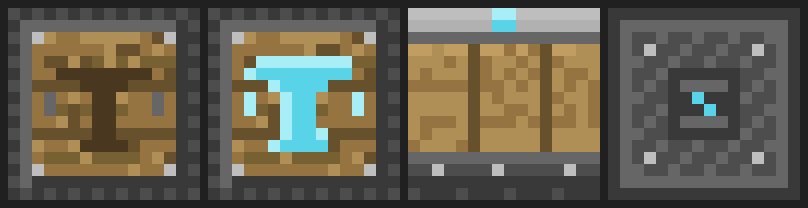

# AE_TC — AE × 匠魂：自动化部件制作台

[](https://minecraft.net)
[](https://files.minecraftforge.net)
[](LICENSE.txt)

把匠魂（Tinkers' Construct）的**部件制作台**做成可以自动化的版本，并且能直接接到**应用能源2（AE2）**的自动合成里。

匠魂原版的部件制作台没有输入输出：`IItemHandler` 的插入/抽出全被禁用（`ConfigurableInvWrapperCapability(this, false, false)`），产出还放在一个不进 capability 的 `LazyResultContainer` 里，所以漏斗、管道、AE 样板供应器一律喂不进去。本模组补上了这一块。

---

## 特性

- **一套真正能交互的界面**：槽位布局与图案按钮网格照匠魂原版部件制作台（图案物品 / 材料 / 产物 + 4×4 形状按钮，可滚轮翻页）。
- **按面 IO**：照 AE2 压印器的做法，不同面负责不同槽位（见下表）。
- **输入齐了自动加工**：产物自动外推到相邻容器（优先朝下）。
- **AE2 原生集成**：方块实现 AE 的 `ICraftingMachine`，样板供应器可以把一单样板整单推进来；合成计算、模式访问终端里的机器显示都正常。
- **材料语义完全走匠魂**：判定用的是匠魂自己的 `MaterialRecipeCache` / `IMaterialItem.canUseMaterial`，所以同一形状下**任何合法材料**都能做，不是写死某个物品。
- **软依赖 AE2**：没装 AE2 时方块依然可用（界面 + 漏斗按面喂料），只是没有样板推料。

### 方块贴图



从左到右：顶面（待机，木台面 + 刻出的镐头轮廓）、顶面（工作中，轮廓发光）、侧面（AE 机身 + 木板 + 能量灯）、底面。配色取样自匠魂部件制作台原版贴图与 AE2 压印器贴图。

---

## 依赖

| 模组 | 版本 | 必需 |
|---|---|---|
| Minecraft | 1.20.1 | ✅ |
| Forge | 47.4.10（47.x 均可） | ✅ |
| Tinkers' Construct（匠魂） | 3.10.2.92 | ✅ 必需 |
| Mantle（匠魂前置） | 1.11.79 | ✅（随匠魂） |
| Applied Energistics 2（AE2） | 15.4.12 | ⭕ 可选 |
| GuideME（AE2 前置） | 20.1.15 | ⭕ 装 AE2 时需要 |

---

## 安装

1. 装好 Minecraft 1.20.1 + Forge 47.x。
2. `mods/` 里放入：**匠魂 + Mantle**（必需），需要 AE 自动化的话再放 **AE2 + GuideME**。
3. 放入本模组的 `ae_tc-<版本>.jar`。

---

## 用法

### 手动使用

1. 放下「自动部件制作台」（创造栏在 `AE 匠魂部件` 分类里，或自己写配方）。
2. 左上角**图案槽**放匠魂的图案物品（`tconstruct:pattern` 或对应模具/金铸模），**材料槽**放材料。
3. 中间会列出所有部件形状：**当前材料做得出的亮着，做不出的压暗**（悬停能看到消耗）。
4. 点一个亮着的形状 → 选中（绿框）→ 产物出现在右侧**产物槽**，随后自动推进相邻容器。

### 接 AE 自动化

1. 把 **ME 样板供应器**贴着机器放（任意一面）。
2. 在样板编码终端里编一个**处理样板**：
   - 输入：`匠魂图案物品 ×1` + `材料物品 ×N`
   - 输出：目标部件（带材质 NBT，例如 `tconstruct:tool_binding`，和形状 id 一致）
3. 供应器把整单推过来，机器从**样板声明的产物反推形状**，扣料、产出、按推出方向弹回，多余材料一并退还。

### 按面 IO

| 面 | 槽位 | 行为 |
|---|---|---|
| 上 | 图案物品 | 只进不出（只接受 `tconstruct:patterns` 标签） |
| 下 | 材料 | 只进不出 |
| 四侧 | 产物 | 只出不进 |
| 未指定面 | 输入槽 0/1 可进、产物槽可出 | 供内部/AE 查询使用 |

---

## 从源码构建

```bash
# 需要 JDK 17
./gradlew build        # Windows: gradlew.bat build
# 产物：build/libs/ae_tc-<版本>.jar
```

开发环境运行：

```bash
./gradlew runClient
./gradlew runServer
```

### 依赖解析说明

- **匠魂 / Mantle** 从 SlimeKnights 的 maven（`dvs1.progwml6.com`）取。
- **AE2 / GuideME** 默认从 CurseForge 的 maven（`cfa2.cursemaven.com`）取。
- 如果你的网络连不上 `cfa2.cursemaven.com`，把这两个 jar 放到项目内离线仓库后即可离线构建：

```
maven-repo/curse/maven/ae2-223794/9357405/ae2-223794-9357405.jar
maven-repo/curse/maven/ae2-223794/9357405/ae2-223794-9357405.pom
maven-repo/curse/maven/guideme-1173950/8204776/guideme-1173950-8204776.jar
maven-repo/curse/maven/guideme-1173950/8204776/guideme-1173950-8204776.pom
```

> jar 名必须是 `<artifactId>-<文件ID>.jar`（Gradle 默认按这个名字找文件），`pom` 最小内容示例：
> ```xml
> <?xml version="1.0" encoding="UTF-8"?>
> <project xmlns="http://maven.apache.org/POM/4.0.0">
>   <modelVersion>4.0.0</modelVersion>
>   <groupId>curse.maven</groupId>
>   <artifactId>ae2-223794</artifactId>
>   <version>9357405</version>
>   <packaging>jar</packaging>
> </project>
> ```

---

## 已知限制

- **一个 AE 样板对应一种形状 + 一种材料物品**。AE 的合成记账要求产物确定，所以不做「任意同材质物品都行」的模糊替换；机器本身接受任何合法材料，但 AE 只会按样板里写的那个物品喂料。
- 匠魂里 `craftable: false` 的材料（例如**铁**，铁部件靠浇筑）在部件制作台里本来就做不出来，这不是 bug。
- 可复用的图案（金铸模等）不会在制作时消耗；用 AE 反复推料时建议先手动把模具放进图案槽，样板里只推材料。
- 方块没有专门的 TESR/动画，`lit` 状态只切换顶面贴图。

---

## 目录结构

```
src/main/java/com/aetc/
├── AeTc.java                           # 模组主类（注册 + 客户端界面注册）
├── Register/
│   ├── AetcBlocks.java                 # 方块与物品
│   ├── AetcBlockEntities.java          # 方块实体
│   ├── AetcMenus.java                  # 容器类型
│   └── AetcTabs.java                   # 创造栏
├── content/machine/
│   ├── AutoPartBuilderBlock.java
│   ├── AutoPartBuilderBlockEntity.java # 槽位 / 配方执行 / 按面 IO / 自动外推
│   └── AutoPartBuilderMenu.java
├── client/AutoPartBuilderScreen.java   # 界面（照匠魂部件制作台）
└── compat/ae2/
    ├── Ae2Compat.java                  # AE2 软依赖门禁
    └── AutoPartBuilderCraftingMachine.java # AE 的 ICraftingMachine 实现
```

`PART-BUILDER-DESIGN.md` 里记录了设计与踩坑记录（匠魂配方 API、图案贴图必须在方块图集里取、AE 附属的扩展惯例等）。

---

## 许可与致谢

- 本模组代码以 MIT 协议发布。
- 感谢 **Applied Energistics 2**（AE 的 `ICraftingMachine` 接口与压印器的按面 IO 设计）与 **Tinkers' Construct / Mantle**（配方 API、图案贴图与界面布局参考）。本模组不包含它们的任何代码或素材，贴图均由脚本程序化生成。
